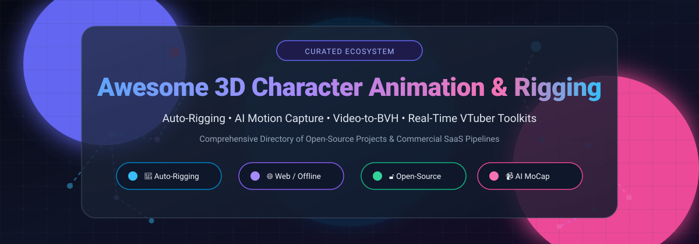

# Awesome-3D-Character-Animation-Rigging 🌟🎭

  

# 🎬 Awesome 3D Character Animation & Rigging Ecosystem

**A Curated Directory of SaaS Platforms & Open-Source Projects for 3D Character Animation, Neural Auto-Rigging, AI Motion Capture, and Real-Time Avatar Pipelines.**

*Turn static 3D meshes, 2D art, and raw video feeds into rigged, production-ready animated characters.*

📅 **Last updated: October 2026** • 🎯 **Category Focus**: 3D Animation, Auto-Rigging, AI MoCap, Markerless Pose Estimation, Blender & Game Engine Toolkits

---

## 🧭 Table of Contents

- [📊 Sector Overview & Market Dynamics](#-sector-overview--market-dynamics)
- [☁️ SaaS / Hosted Platforms](#️-saas--hosted-platforms)
- [🔓 Open-Source GitHub Projects](#-open-source-github-projects)
- [💡 Additional Open-Source Assets & Core Engines](#-additional-open-source-assets--core-engines)
- [🤝 How to Contribute](#-how-to-contribute)
- [💖 Support & Sponsorship](#-support--sponsorship)
- [📈 Star History](#-star-history)
- [⚠️ Disclaimer](#️-disclaimer)

---

## 📊 Sector Overview & Market Dynamics

The global 3D animation and character rigging software market is valued at **$15B – $30B**, with the specialized motion capture sub-segment accounting for **$300M – $1B+** as real-time tracking expands. The sector exhibits a dual market structure: foundational DCC software pipelines and high-end optical capture hardware are **highly concentrated** around legacy incumbents (e.g., Adobe, Autodesk), while AI-driven markerless capture, browser-based auto-rigging, and indie animation toolkits are **moderately to highly fragmented** with rapid startup and open-source innovation.

---

## ☁️ SaaS / Hosted Platforms

| Product | Description | Company Scale (Revenue / Valuation) | Pricing | Free Tier Limit |
| :--- | :--- | :--- | :--- | :--- |
| **[Mixamo (Adobe)](https://www.mixamo.com/)** | Browser-based auto-rigger and animation library with 2,000+ motion-capture clips. | **~$26B Revenue / ~$250B Valuation** (Adobe Inc., NASDAQ: ADBE) | **$0** (Free with an Adobe account) | **Free forever**: Full access to 2,000+ mocap animations and auto-rigging pipeline; standard commercial use permitted. |
| **[Wonder Dynamics (Autodesk Flow Studio)](https://www.autodesk.com/)** | AI-powered character animation, mocap, and VFX pipeline from video (formerly Wonder Studio). | **~$7.8B Revenue / ~$50B Valuation** (Autodesk, NASDAQ: ADSK) | Paid tiers start at **$7/month** (Lite plan, billed annually at $84/yr) or $10/month billed monthly; Pro at $64/month | **Free forever tier**: 300 credits/mo, max 720p export, 1 concurrent job, 1 actor tracking per project, 1 GB storage, 3 custom characters, watermarked outputs. |
| **[Cascadeur](https://cascadeur.com/)** | AI-assisted keyframe animation software with physics-based posing. | **~$20M – $50M Est. Revenue** (Nekki, parent gaming studio) | **$8/month** (Indie plan, billed annually at $96/yr) or $19/month billed monthly; Pro at $33/month | **Free forever plan**: Non-commercial use only, export strictly limited to proprietary `.casc` format (no standard FBX/DAE/USD export). |
| **[Rokoko Studio](https://www.rokoko.com/products/studio)** | Motion capture suite for Rokoko hardware and AI video tracking. | **~$50M – $100M Valuation** (~$13.7M venture funding raised) | **$10/month** (Basic plan, billed annually) or $15/month billed monthly; Plus at $20/month, Pro at $50/month | **Starter plan (free forever)**: Basic recording and motion capture editing, 30 seconds/month Vision AI video mocap processing, 5 text-to-motion imports/mo, 1 month cloud storage. |
| **[AccuRIG (Reallusion)](https://www.reallusion.com/auto-rig/accurig.html)** | Standalone auto-rigging tool for humanoid 3D characters. | **~$7M – $9M Annual Revenue** (Reallusion Inc., TPEX: 6882) | **$0** (Standalone software is completely free; optional ActorCore motions priced individually or via packs) | **Free forever plan**: Unlimited auto-rigging and FBX/USD exports with full commercial rights; limited to humanoid biped meshes and ~30 free sample motions from ActorCore. |
| **[Move.ai](https://www.move.ai/)** | Markerless single-camera (Move One iOS) and multi-camera motion capture. | **<$50M Valuation** ($1M – $10M ARR est., venture-backed) | **$18/month** (Move One Starter tier, credit-based) or usage-based at $0.012/sec (s1 single-cam); custom enterprise pricing for Genesis multi-cam volumes | **Free plan (Move One iOS)**: One-time allotment of 30 credits (non-expiring), max 30 seconds per video capture; multi-camera Genesis workflows require a scheduled enterprise demo/trial. |
| **[DeepMotion](https://www.deepmotion.com/)** | AI video-to-3D motion capture and real-time body tracking platform. | **~$1.4M ARR est.** (Venture-backed / strategic AI footprint) | **$9/month** (Starter plan for Animate 3D, billed annually at $108/yr) or $15/month billed monthly | **Freemium plan (free forever)**: 25 animation credits/month (1 credit = 1 sec body animation), max 20 seconds per video, max 2 persons tracked, 1080p@30fps, strictly personal non-commercial use. |
| **[Plask Motion](https://plask.ai/)** | Browser-based AI motion capture from video for animators and digital creators. | **~$1.4M ARR est.** ($2.56M total venture funding raised) | **$18/month** (Standard plan, billed annually) or $40/month billed monthly; Pro tier at $50/month (billed annually) | **Freemium plan (free forever)**: Up to 900 daily credits (~15–30s of AI mocap processing daily), basic keyframe editing, limited personal non-commercial export. |

---

## 🔓 Open-Source GitHub Projects

*Sorted in descending order by GitHub_Stars.*

- **[EasyMocap](https://github.com/zju3dv/EasyMocap)**   
  🏃 **The Comprehensive Motion Capture Toolkit.** Open-source framework developed by Zhejiang University for human motion capture, 3D pose estimation, and parametric body model (SMPL/SMPL-X) recovery from both monocular and multi-camera synchronized setups. Best for researchers and technical directors building studio-grade markerless pipelines.

- **[Mesh2Motion](https://github.com/Mesh2Motion/mesh2motion-app)**   
  🦴 **The MIT-Licensed Mixamo Alternative.** Import a 3D model (GLB/GLTF), choose a skeleton preset, interactively adjust joint placements to fit the geometry, preview animation clips, and export—completely client-side or self-hosted via Docker (`docker-compose up -d` → `localhost:3000`). All accompanying assets, rigs, and animations carry a **CC0 license** for unrestricted commercial and private use.

- **[SysMocap](https://github.com/xianfei/SysMocap)**   
  🎥 **Real-Time Cross-Platform Avatar Driving System.** Desktop application (Windows, macOS, Linux) that turns an ordinary webcam feed into full-body, hand, and facial motion capture. Drives custom 3D avatars (VRM, GLB, FBX) in real time with integrated OBS virtual camera support for VTubers, live streamers, and real-time animators.

- **[Low-Cost-Mocap](https://github.com/jyjblrd/Low-Cost-Mocap)**   
  🎯 **Room-Scale Outside-In Optical Tracking.** An open-source, budget-friendly optical motion capture pipeline utilizing budget cameras (e.g. modified Sony PS3 Eye cameras with IR bandpass filters) and retroreflective active/passive markers. Triangulates multi-view 3D marker coordinates using epipolar geometry and bundle adjustment for robotics, VR room tracking, and indie motion capture.

- **[FrankMocap](https://github.com/facebookresearch/frankmocap)**   
  🤖 **Meta AI Single-View 3D Hand + Body Motion Estimator.** High-speed, robust monocular mocap system integrating separate deep-learning body and hand modules. Produces 3D SMPL-X parametric meshes and joint rotations directly from standard monocular RGB video feeds without dedicated depth cameras or calibration grids.

- **[UniRig](https://github.com/VAST-AI-Research/UniRig)**   
  🧬 **Universal Autoregressive Rigging [SIGGRAPH 2025].** Deep-learning framework by Tsinghua University and VAST/Tripo that breaks the boundary of humanoid-only auto-rigging. Utilizes skeleton tree tokenization and bone-point cross-attention to automatically generate topologically valid bone hierarchies and smooth skinning weights for arbitrary creatures, bipeds, quadrupeds, and fictional fantasy models.

- **[RigNet](https://github.com/zhan-xu/RigNet)**   
  🧠 **Neural Rigging for Articulated Characters [SIGGRAPH 2020].** Seminal academic baseline that automates character rigging directly from 3D surface meshes. Predicts kinematic joint locations, connects them into a hierarchical skeleton tree, and calculates smooth skinning weight envelopes without requiring any pre-defined template topology.

- **[MAMMA](https://github.com/cuevhv/mamma)**   
  👥 **Markerless Accurate Multi-Person Motion Acquisition.** Deep-learning multi-person 3D human pose recovery framework that handles complex multi-subject interactions, occlusions, and fast athletic motions from video feeds without traditional wearable sensors.

- **[PSD2Live](https://github.com/tsunehimatoi/psd2live)**   
  🎨 **Automated Layered PSD to Live2D Rigging Pipeline.** Converts layered Photoshop (PSD) character art into functional Live2D Cubism models (`.moc3`/`.cmo3`), complete with rigging, physics, deformation meshes, and VTube Studio-ready tracking parameters without manual mesh point slicing.

- **[Reze MiPo](https://github.com/AmyangXYZ/reze-mipo)**   
  🌐 **In-Browser Real-Time MMD Motion Capture Engine.** High-performance WebGPU/WebGL client-side tracking application leveraging MediaPipe Holistic to track body, hands, and facial blendshapes via browser webcam and translate movements directly to MMD/PMX 3D characters in real time.

- **[SkinTokens](https://github.com/VAST-AI-Research/SkinTokens)**   
  📐 **Learned Compact Representation for Autoregressive Rigging.** Successor to UniRig that formulates skin weight painting into discrete skin tokens. Enables end-to-end autoregressive skin prediction with reinforcement learning optimization, significantly cutting skinning deformation artifacts across complex non-rigid joints.

- **[MoCapAnything V2](https://github.com/phongdaot/MocapAnything)**   
  ⚡ **End-to-End Motion Capture for Arbitrary Skeletons [SIGGRAPH Asia 2026].** Joint optimization framework transforming monocular video directly into BVH-ready skeletal joint rotations for humans, animals, quadrupeds, and custom mechanical rigs—delivering ~20× faster performance than traditional iterative mesh-fitting pipelines.

- **[Reze MiPo Desktop](https://github.com/BesingBG/reze-mipo-desktop)**   
  💻 **Offline Native MMD AI Video-to-VMD Exporter.** Standalone cross-platform desktop wrapper for the Reze MiPo engine. Enables zero-cloud, fully local processing of video clips and live webcam streams directly into `.vmd` motion files for MikuMikuDance production.

---

## 💡 Additional Open-Source Assets & Core Engines

- **[mesh2motion-assets](https://github.com/Mesh2Motion/mesh2motion-assets)**  — The accompanying CC0-licensed asset repository (curated 3D meshes, skeleton hierarchies, and animation tracks) powering the Mesh2Motion application.

---

## 🤝 How to Contribute

Contributions are warmly welcomed! Help keep this directory accurate, up-to-date, and comprehensive:

1. 🍴 **Fork the repository**.
2. 🌿 **Create a new branch** (`git checkout -b feature/add-new-tool`).
3. 📝 **Add or update an entry** in `README.md` following the established table / list format. Include pricing details and free tier limits for SaaS, or a verified GitHub Stars_Badge for open-source entries.
4. 🚀 **Commit and push** your changes (`git commit -m "feat: add NewTool entry"`).
5. 📬 **Open a Pull Request** with a brief summary of the software or repository added.

---

## 💖 Support & Sponsorship

If this curated repository saved you time, helped your indie game development pipeline, or assisted your 3D animation workflow, please consider supporting the project!

- ⭐ **Star this repository** to improve discoverability for other artists, animators, and developers.
- 🍴 **Fork and share** with fellow animators, VTubers, and game dev communities.
- ☕ **Sponsor / Buy Me a Coffee**: If you'd like to support ongoing curation and tool benchmarks, visit the [**GitHub Sponsor Dashboard**](https://github.com/sponsors/ishandutta2007). Your support is deeply appreciated! ❤️

---

## 📈 Star History

---

## ⚠️ Disclaimer

- This is an **independent, community-curated directory** created for informational, educational, and research purposes. Listing does not constitute an endorsement.
- **Mixamo (Adobe)** continues to provide the most generous commercial-friendly free tier in the category (2,000+ motions, full auto-rigging pipeline with standard commercial usage allowed). Open-source platforms like **Mesh2Motion** are catching up rapidly with fully self-hostable, CC0-licensed pipelines.
- **Terms of Service & Licensing**: Always verify licensing terms before production deployment. Certain free tiers (e.g., Cascadeur, DeepMotion) explicitly restrict outputs to personal or non-commercial use, or require proprietary file formats unless upgraded to indie/commercial subscriptions.
- **Hardware vs. Markerless Quality**: Single-camera markerless solutions (e.g. Move One, Reze MiPo, MoCapAnything) deliver rapid turnarounds with zero hardware cost, but multi-view camera arrays and inertial/optical suits (e.g. Rokoko, Move Pro) provide higher spatial accuracy for acrobatic stunts and close multi-character contact.

---

**Built with ❤️ for 3D Artists, Riggers, Animators, Indie Game Developers, and VTubers worldwide.**  
*Democratizing character animation, neural rigging, and markerless motion capture.*

